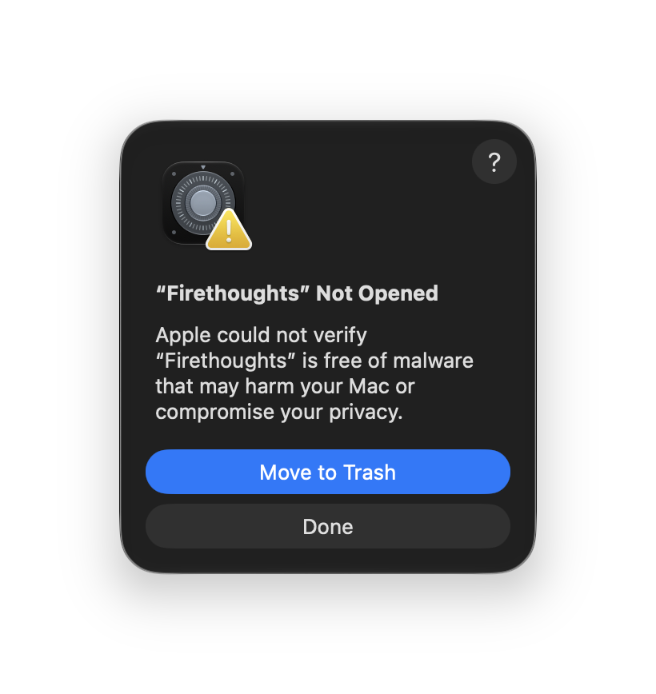
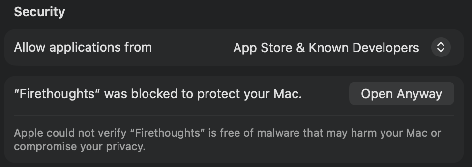

# Firethoughts

A canvas in your Mac's menu bar for catching thoughts before they slip away.
Click the spark icon and Firethoughts opens right under it: type, add a sticky
note, draw, paste a picture or a link, then put it away and carry on. Seven
canvases, called Sparks, each keep their own notes.

Free. Needs **macOS 26.5 or later**.

## Install

1. Download `Firethoughts-<version>.dmg` from the
   [latest release](https://github.com/xyiencefiction/firethoughts-releases/releases/latest).
2. Open the DMG and drag **Firethoughts** onto **Applications**.
3. Open Firethoughts from your Applications folder.

### The first time: "Firethoughts" Not Opened

Firethoughts is free and made by one person, without Apple's paid developer
program, so Apple has not checked it. The first time you open it, macOS stops it:

Click **Done** (not Move to Trash). Then:

1. Open **System Settings › Privacy & Security**.
2. Scroll down to **Security**. It says "Firethoughts" was blocked. Click
   **Open Anyway**:

   

3. Type your password (or use Touch ID).
4. macOS asks once more whether to open Firethoughts. Choose to open it.

You do this once. Firethoughts lives in the menu bar: look for the spark icon.

**If you like Terminal,** one command does the same, after you dragged the app
into Applications:

    xattr -dr com.apple.quarantine /Applications/Firethoughts.app

### New versions

Firethoughts checks for a new version about once a day. When one is ready, a
small orange dot appears on the spark icon: right-click it and choose
**Update Available…**. Updates install inside the app, so you should not see
the "Not Opened" message again, and your notes stay where they are.

## Privacy

- Your notes stay on your Mac, as plain files in Firethoughts' own folder,
  unless you use AI with them. No account, no cloud, no analytics.
- Link cards ask the linked website for its title and picture.
- Once a day, Firethoughts asks this page on GitHub whether there is a new
  version. You choose when to install it.
- Chat sends your messages and the Sparks you enable to the AI you chose. Its
  own privacy rules apply.
- Firethoughts forgets your chats when you quit. API keys are kept in your
  Mac's Keychain.
- Other AI apps on your Mac see your notes only while you allow it in
  **Settings › AI**.

## Found a problem?

Right-click the spark icon and choose **About Firethoughts**. Send me the
version and build shown there, and what happened.
